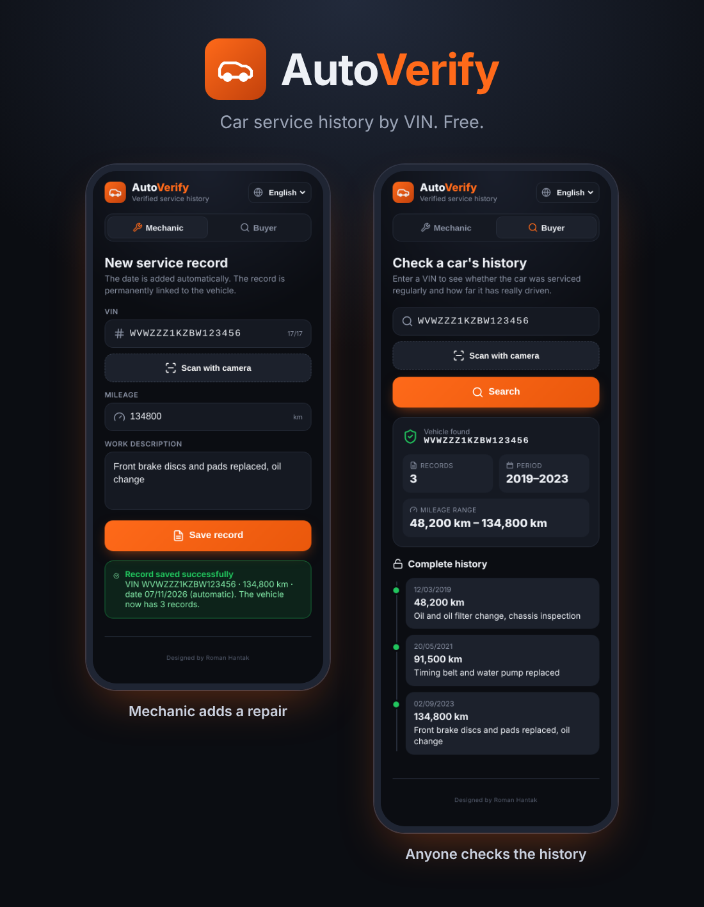
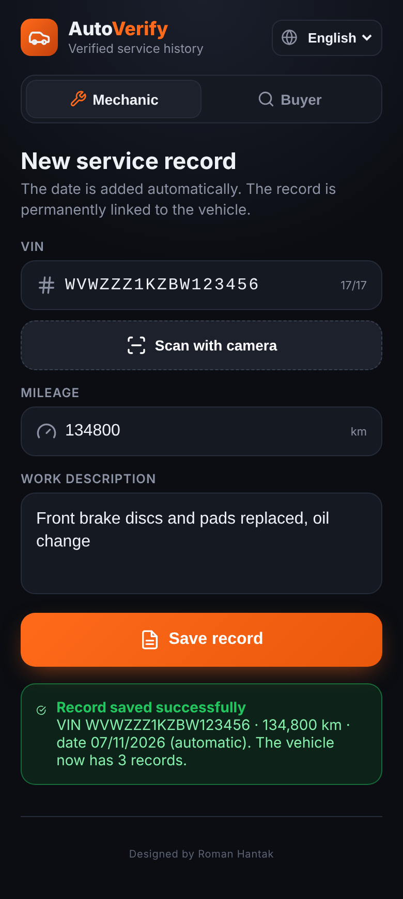
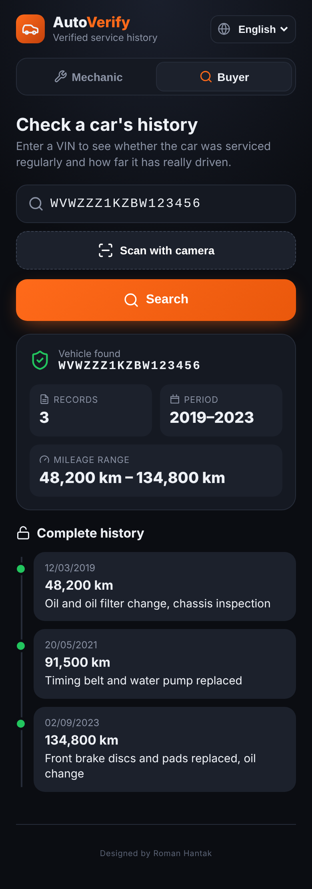

  

# 🚗 AutoVerify

**Car service history by VIN. Free.**

👉 **Open the app: [rhanty.github.io/autoverify](https://rhanty.github.io/autoverify/)**

---

## What is AutoVerify?

AutoVerify records car service work against the car's **VIN (Vehicle Identification Number)**.

Car brands change, merge, get sold or disappear, but **the VIN stays with the car for its entire life**. That is why the history is stored against the VIN, not the brand, the owner or the licence plate.

Anyone who wants to check a car's history can simply enter the VIN and see it **for free**, with no sign-up and no payment.

---

## How it works

### 🔧 Mechanic (adding records)
1. Enter the VIN, or tap **Scan with camera** and take a photo of it. The app reads the number for you.
2. Enter the current mileage.
3. Describe the work, for example "Oil, filters and front brakes replaced".
4. Tap **Save record**. Today's date is added **automatically**, so the mechanic never has to enter it.

### 🔍 Buyer (checking a car)
1. Enter the VIN of the car you are interested in, or tap **Scan with camera** and photograph it.
2. Instantly see the **complete history**: dates, mileage and the work done, on a clear timeline.
3. Free, no login.

---

## App preview

  
  &nbsp;&nbsp;&nbsp;
  

<em>Left: a mechanic adds a repair. Right: a buyer sees the car's history. The screenshots are illustrations with sample data.</em>

---

## 📲 Add the app to your phone

There is nothing to download from an app store. The app opens in your browser and you can add it to your home screen, where it behaves like a regular app.

### iPhone (iOS)
1. Open **[rhanty.github.io/autoverify](https://rhanty.github.io/autoverify/)** in **Safari**.
2. Tap the **Share** button (the square with an arrow pointing up, in the bottom bar).
3. Choose **Add to Home Screen**.
4. Tap **Add**. The AutoVerify icon with the orange car appears on your home screen.

### Android
1. Open **[rhanty.github.io/autoverify](https://rhanty.github.io/autoverify/)** in **Chrome**.
2. Tap the **⋮** menu (three dots, top right).
3. Choose **Install app** or **Add to Home screen**.
4. Confirm. The AutoVerify icon appears among your apps.

### Computer
Just open [rhanty.github.io/autoverify](https://rhanty.github.io/autoverify/) in any browser.

> The first time you scan, your phone asks for permission to use the camera.

---

## 📷 Scanning the VIN with the camera

Tap **Scan with camera**. Your phone's camera opens, take a photo of the VIN (on the plate, the windscreen or the registration document) and the app reads the number from the photo. Mechanics and buyers can both use it.

You can always correct the number by hand before saving or searching.

Tips: good light, a sharp close-up, the VIN filling most of the photo.

---

## 🌍 Languages

Cars have VINs all over the world, so the app is available in 23 languages. Pick yours in the top right corner:

Slovenčina, English, Deutsch, Español, Français, Polski, Čeština, Magyar, Italiano, Português, Русский, Українська, Română, Nederlands, Türkçe, العربية, हिन्दी, 简体中文, 日本語, 한국어, Bahasa Indonesia, Tiếng Việt, Svenska.

Repair descriptions are shown in the language in which the mechanic wrote them.

---

## ℹ️ Important information

- **Records are entered by workshops and mechanics.** AutoVerify does not check or guarantee that they are correct or complete. The history is an informative aid and does not replace an inspection of the car or professional advice.
- **Only this is stored:** VIN, mileage, work description and date. No personal data about owners.
- The app is free to use.

---

## 🛠 Built with

React · Supabase (database) · GitHub Pages (hosting)

---

Designed by Roman Hantak

